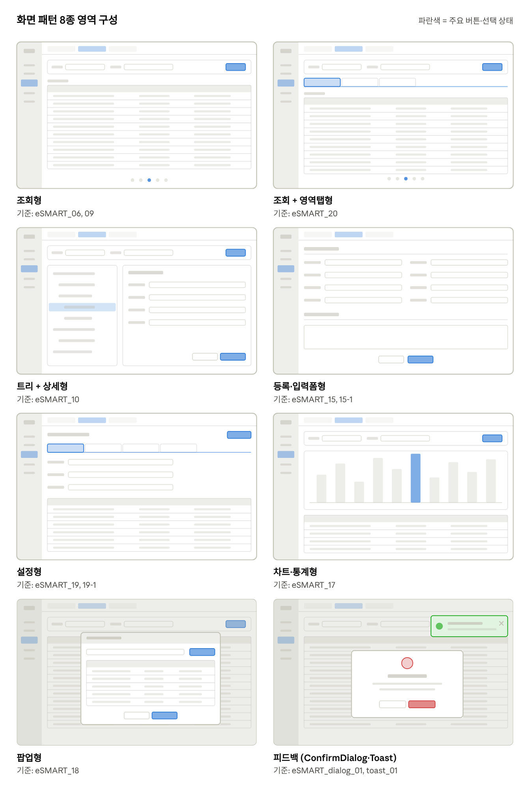
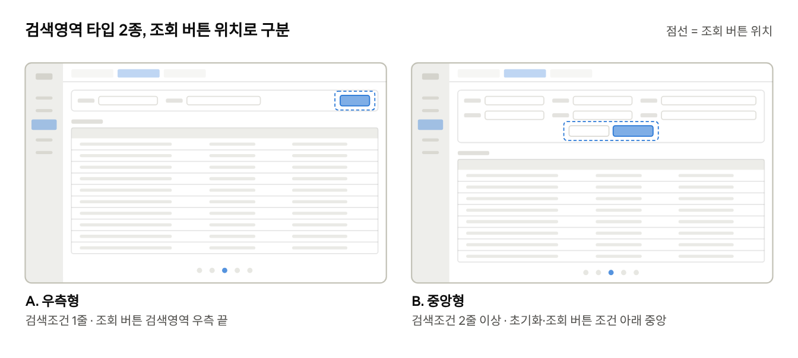
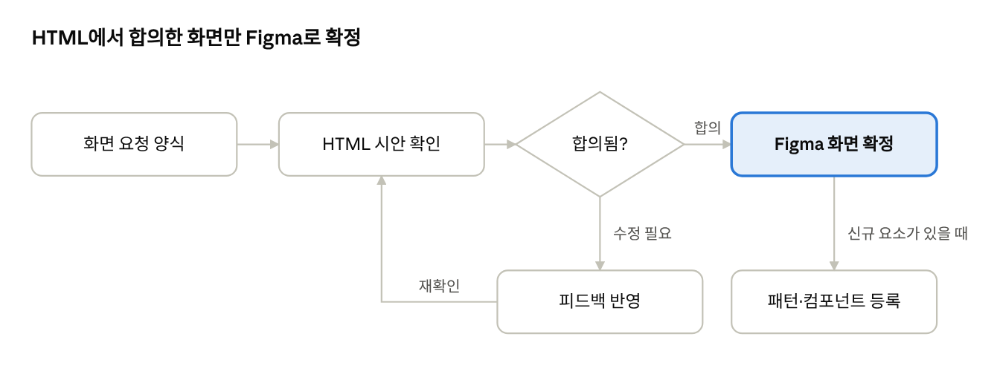

# eSMART 화면 요청 양식 · 컴포넌트 사용 가이드

2026-10-13 · 송이

## 1. 문서 목적

스토리보드 없이 요건정리 문서에서 바로 화면 작업을 요청하기 위한 기준. 기획자는 **화면 패턴 선택 + 요청 양식 작성**만으로 화면 요청 가능.

1. 요건정리 문서 작성 (메뉴·기능 단위)
2. 화면별로 **화면 패턴** 선택 (3장)
3. **화면 요청 양식** 작성 (5장, 예시는 6장)
4. HTML 시안으로 빠르게 확인·수정 → 합의
5. Figma 화면으로 확정 (eSMART_XX)

컴포넌트 선택이 애매할 때는 4장 사용 가이드 참고. 공통 영역(LNB, Page Tab 등)은 2장 기준으로 자동 적용되므로 요청서에 적지 않음.

## 2. 화면 공통 기준

모든 화면에 고정 적용되는 조건. 화면 요청 시 따로 적지 않아도 됨.

| 항목 | 기준 |
| --- | --- |
| 화면 스타일 | eSMART_01~08 기준 (1920 해상도, 브라우저 프레임 포함) |
| LNB | 기존 컴포넌트 그대로. 해당 메뉴만 활성 표시 |
| Page Tab | 기존 탭 유지, 활성 탭 라벨만 화면명으로 변경 |
| 컨텐츠 구성 | 검색영역(상단 고정) + 컨텐츠 영역(남은 높이 채움) |
| 그리드 | grid 컴포넌트 + 샘플 데이터, 화면 높이에 맞춰 채움 |
| 컴포넌트 | 기존 컴포넌트명·컬러 변수 유지 |
| 개발 기준 | PrimeReact v9. 신규 컴포넌트는 PrimeReact 구조 기준으로 추가 |
| 화면 ID | eSMART_XX, 파생안은 eSMART_XX-1 |

## 3. 화면 패턴 카탈로그

화면 요청 시 아래 패턴 중 하나 선택. 기준 화면은 Figma 「시안」 페이지의 해당 화면.



**검색영역 타입.** 검색영역이 있는 모든 패턴(조회형, 조회+영역탭형, 트리+상세형, 차트·통계형, 팝업형)에 A/B 중 하나 적용. 기본은 검색조건 줄 수 기준으로 자동 결정, 예외 화면만 요청 양식에 타입 명시.



| 패턴 | 구성 | 사용 상황 | 기준 화면 |
| --- | --- | --- | --- |
| 조회형 | 검색영역 + Total·목록 헤더 + 그리드 + 페이지네이션 | 목록 조회, 이력 확인 | eSMART_06, eSMART_09 |
| 조회 + 영역탭형 | 검색영역 + area-tab + 탭별 그리드 | 같은 조건, 다른 분류의 목록 | eSMART_20 |
| 트리 + 상세형 | 좌측 트리 + 우측 상세 폼 | 메뉴·코드·조직 등 계층 관리 | eSMART_10 |
| 등록·입력폼형 | 섹션별 입력 폼 + 하단/상단 버튼 | 신규 등록, 수정 | eSMART_15, eSMART_15-1 |
| 설정형 | 탭 + 설정 항목 폼·테이블 | 환경·조건 설정 | eSMART_19, eSMART_19-1 |
| 차트·통계형 | 검색영역 + 차트 + 요약 그리드 | 통계, 추이 분석 | eSMART_17 |
| 팝업형 | dim + dialog (header·본문·버튼) | 화면 이동 없이 선택·입력 | eSMART_18 |
| 피드백 | ConfirmDialog 5종, Toast 4종 | 확인·경고·완료 안내 | eSMART_dialog_01, eSMART_toast_01 |

패턴에 없는 화면은 「신규 패턴」으로 요청. 확정 후 카탈로그에 추가.

## 4. 컴포넌트 사용 가이드

기획 단계에서는 「무엇을 하려는지」만 정하면 되고, 컴포넌트는 아래 기준으로 자동 선택.

### 검색영역

| 상황 | 컴포넌트 | 비고 |
| --- | --- | --- |
| 정해진 목록에서 1개 선택 | dropdown | 기본값 명시 (예: 전체) |
| 목록이 많고 검색 필요 | autocomplete | 거래처, 품목 등 |
| 자유 입력 | inputtext | placeholder 문구 명시 |
| 기간 프리셋 + 기간 | selectbutton + datepicker | 버튼 선택 시 날짜 연동, 기본 선택값 명시 |
| 복수 선택 (소수) | checkbox+label | 4개 이하 |
| 단일 선택 (소수) | radio+label | 4개 이하 |
| 조회·초기화 | button primary + 아이콘 버튼(refresh) | A 우측형: 조건 1줄, 검색영역 우측 끝 · B 중앙형: 조건 2줄 이상, 조건 아래 중앙 |

### 목록·그리드

- **컬럼 정의:** 컬럼명, 정렬(좌/중/우), 형식(날짜·숫자·%), 소팅 여부
- **선택:** 복수 처리(삭제·다운로드)가 있을 때만 체크박스 컬럼
- **헤더 2줄:** 컬럼명이 길거나 그룹 헤더가 필요할 때 grid header=2row
- **목록 헤더:** Total 건수 + 목록 내 검색(inputtext + 돋보기 버튼) + 엑셀 등 목록 단위 버튼
- **데이터 없음:** 그리드 영역 안에 노데이터 문구 표시
- **페이지:** paginator 기본. 건수가 적은 팝업 목록은 스크롤

### 탭

- **area-tab:** 한 화면 안에서 컨텐츠 분류 전환 (기획 대상)
- **page-tab:** 열린 메뉴 화면 전환 (공통 영역, 기획 대상 아님)

### 버튼

| variant | 용도 |
| --- | --- |
| primary | 화면의 핵심 동작 1개 (조회, 저장, 등록) |
| secondary / outline | 보조 동작 (취소, 목록, 추가) |
| neutral / subtle | 목록 내 보조 기능, 아이콘 버튼 |
| danger | 삭제 확정 등 되돌릴 수 없는 동작 (다이얼로그 내) |
| danger-outline | 화면 내 삭제 버튼 |

### 메시지 · 피드백

| 상황 | 컴포넌트 | type / severity |
| --- | --- | --- |
| 삭제 등 되돌릴 수 없는 동작 확인 | ConfirmDialog | danger |
| 작성 중 이탈, 주의 필요 | ConfirmDialog | warning |
| 저장·등록 후 다음 행동 안내 | ConfirmDialog | success |
| 정보 안내·확인 | ConfirmDialog | info |
| 세션 만료 등 텍스트 안내 | ConfirmDialog | default (아이콘 없음) |
| 동작 결과 알림 (흐름 유지) | Toast | success / info / warn / error |

판단 기준: 사용자가 **선택을 해야 하면 ConfirmDialog**, **알기만 하면 되면 Toast**.

## 5. 화면 요청 양식

화면 1개당 1장. 필수 항목만 채워도 작업 가능하고, 빈 항목은 패턴 기본값 적용.

| 항목 | 필수 | 작성 내용 |
| --- | --- | --- |
| 화면 ID / 화면명 | ● | eSMART_XX / Page Tab에 표시되는 이름 |
| LNB 위치 | ● | 1depth > 2depth |
| 화면 패턴 | ● | 3장 패턴 중 선택, 또는 신규 패턴 |
| 화면 목적 | ● | 누가, 무엇을 확인·처리하는 화면인지 1줄 |
| 검색조건 |  | 항목명 / 입력 방식 / 기본값 / 필수 여부 + 검색영역 타입(A 우측형 / B 중앙형, 비우면 기준 적용) |
| 탭 구성 |  | area-tab 항목과 기본 선택 탭 |
| 목록 컬럼 |  | 컬럼명 / 정렬 / 형식 / 소팅 여부 |
| 입력 항목 |  | 등록·설정 화면: 항목명 / 입력 방식 / 필수 / 기본값 |
| 버튼·액션 |  | 버튼명과 눌렀을 때의 동작 |
| 메시지·팝업 |  | 상황 / ConfirmDialog·Toast 종류 / 문구 |
| 예외 처리 |  | 데이터 없음, 권한 없음, 필수값 누락 |
| 참고 화면 |  | 기존 eSMART 화면, 설계서 캡쳐, 외부 레퍼런스 |

복사해서 쓰는 텍스트 양식:

```
화면 ID / 화면명 :
LNB 위치       :
화면 패턴       :
화면 목적       :
검색조건       :
검색영역 타입  : A 우측형 / B 중앙형
탭 구성         :
목록 컬럼       :
입력 항목       :
버튼·액션       :
메시지·팝업     :
예외 처리       :
참고 화면       :
```

## 6. 작성 예시 — eSMART_20 Alarm History Report

실제 작업한 화면 기준 예시. 이 정도 분량이면 바로 화면 작업 가능.

| 항목 | 내용 |
| --- | --- |
| 화면 ID / 화면명 | eSMART_20 / Alarm History Report |
| LNB 위치 | 감염관리 > (해당 메뉴) |
| 화면 패턴 | 조회 + 영역탭형 |
| 화면 목적 | 공장·제품별 이상 알람 발생 이력 조회 |
| 검색조건 | 조회 항목: dropdown 2개 (공장 / 제품) · 조회 기간: selectbutton(당일·1주일·1개월·3개월·6개월, 기본 당일) + datepicker, 버튼 선택 시 날짜 연동 |
| 탭 구성 | 생산계획 대비 실적 이상(기본) / 품질 이상 / 설비 이상 |
| 목록 컬럼 | 체크박스 · 공장(중) · 제품(중) · 발생시간(중, YYYY-MM-DD HH:mm) · 계획수량(개, 우) · 생산실적(개, 우) · 납기준수율(%, 우), 전체 소팅 |
| 버튼·액션 | 조회, 초기화(아이콘) · 목록 내 검색(공장·제품 검색 + 돋보기 버튼) |
| 예외 처리 | 조회 결과 없음 → 그리드 노데이터 문구 |
| 참고 화면 | eSMART_06 (조회형 기본 구성) |

## 7. 작업 진행 방식

HTML은 빠른 탐색·수정용, Figma는 확정 화면 기록용으로 역할 구분.



- **HTML 시안:** PrimeReact v9 구조 + eSMART 컴포넌트·토큰. 문구, 컬럼, 배치를 대화로 즉시 수정
- **Figma 확정:** 합의된 HTML 시안을 Figma 컴포넌트로 제작, 「시안」 페이지에 eSMART_XX로 배치
- **이름 1:1 일치:** HTML 클래스·컴포넌트명은 Figma 컴포넌트명과 동일 (grid, selectbutton, area-tab, confirm-dialog, toast 등)
- **신규 요소:** 패턴·컴포넌트가 새로 생기면 Components 페이지와 3·4장에 함께 반영
- **파생안:** 기존 화면은 유지하고 eSMART_XX-1로 추가
- **피드백:** 화면 단위로 요청 (예: “eSMART_20 그리드 높이 채움, 드롭다운 삭제”)

Figma 페이지 구성 제안: 00 가이드 · 01 Foundation · 02 Components · 03 Patterns · 04 Screens(LNB 메뉴 순) · 05 Dialog·Feedback · 99 Archive
